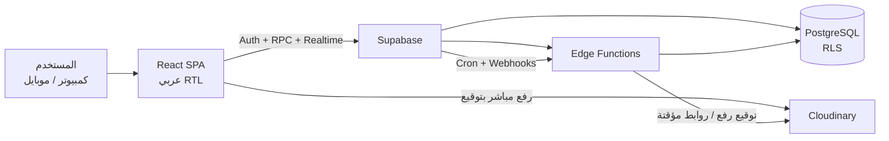

# نظام إدارة وحسابات معرض التكاتك والموتوسيكلات والمركبات

## ملف المتطلبات المنظم وخطة المراحل

| البند | التفاصيل |
|---|---|
| المصدر | `Requirements.txt` — 24 قسمًا من مواصفات المعرض |
| نسخة الملف | 1.0 |
| التاريخ | 24 أكتوبر 2026 |
| التقنيات المعتمدة | React + Supabase + Cloudinary |
| حالة الملف | مسودة منظمة جاهزة للمراجعة والاعتماد |
| عدد المراحل | 10 مراحل (من 0 إلى 9) |
| ملف التنفيذ المرحلي | `stages.md` — 62 مرحلة تنفيذية + مرحلة تحضيرية M0.0 |
| قاعدة العمل | لا يبدأ تنفيذ مرحلة قبل اعتماد المرحلة السابقة وبوابة خروجها |

> **ملاحظة مهمة:** هذا الملف هو المرجع الرسمي المنظم للمشروع. الملف الأصلي `Requirements.txt` يظل محفوظًا كما هو. أي طلب جديد بعد اعتماد هذا الملف يُسجَّل كطلب تغيير (Change Request) مع تحديد أثره على المراحل، ولا يُضاف مباشرة إلى التنفيذ.

---

## 1. الملخص التنفيذي

نظام ويب عربي متكامل لإدارة معرض بيع التكاتك والموتوسيكلات والمركبات والمنتجات الأخرى، يغطي:

- العملاء والموردين والضامنين.
- المخزون والمركبات والمشتريات.
- المبيعات النقدية والآجلة والعقود.
- جداول الأقساط والتحصيلات الجزئية وإعادة الجدولة.
- الخزنة والبنوك والمصروفات.
- المستندات والصور ووصلات الأمانة.
- كشوف الحسابات والتقارير والتصدير.
- المستخدمين والصلاحيات وسجل المراجعة.
- النسخ الاحتياطي والأمان.

**الشكل الفني المعتمد:**

- **React** لواجهة عربية RTL تعمل على الكمبيوتر والموبايل.
- **Supabase** كخلفية متكاملة: PostgreSQL + Auth + Row Level Security + Edge Functions + Scheduled Jobs.
- **Cloudinary** لتخزين الصور والمستندات برفع آمن وروابط مؤقتة محمية.

تم توسيع مراحل التنفيذ الستة الواردة في الملف الأصلي إلى **10 مراحل قابلة للاعتماد والتسليم**، مع الحفاظ على نفس الترتيب المنطقي: الأساس، ثم البيانات الرئيسية، ثم المخزون والمشتريات، ثم المبيعات، ثم الأقساط، ثم الخزنة والمحاسبة، ثم المستندات والتقارير، ثم الاختبار والتشغيل.

---

## 2. أهداف النظام

1. توحيد كل تعاملات العميل في ملف واحد: بياناته، مشترياته، عقوده، أقساطه، مدفوعاته، مستنداته، وملاحظاته.
2. ربط كل عملية بيع أو شراء أو تحصيل أو مصروف بالأثر المالي والمخزني والتقارير تلقائيًا.
3. منع الأخطاء المالية والمخزنية: بيع المركبة مرتين، الصرف بدون رصيد، حذف عملية معتمدة، أو احتساب قسط مستقبلي كمتأخر.
4. توفير صلاحيات دقيقة حسب الدور والفرع، مع فصل صلاحيات المستندات الحساسة عن صلاحيات التعديل المالي.
5. إنتاج كشوف حسابات وتقارير قابلة للطباعة والتصدير بصيغ PDF وExcel وCSV وصور.
6. بناء نظام قابل للتوسع لعدة فروع، مع إمكانية البدء بفرع واحد.
7. توفير سجل مراجعة كامل ونسخ احتياطي قابل للاستعادة.

---

## 3. نطاق المشروع

### 3.1 داخل النطاق

- تطبيق ويب عربي RTL متجاوب.
- إدارة المستخدمين والأدوار والصلاحيات والفروع.
- العملاء وجهات التواصل والضامنون.
- الموردون والمشتريات وفواتير الشراء.
- المنتجات والمركبات والمخزون والجرد والتحويل بين الفروع.
- المبيعات النقدية والتقسيط والعقود والمرتجعات والإلغاءات.
- جداول الأقساط والتحصيلات الجزئية وتوزيع الدفعات وإعادة الجدولة.
- الخزائن والحسابات البنكية والتحويلات وإغلاق الوردية.
- المصروفات وحسابات العملاء والموردين.
- محرك محاسبي مبسط بقيود يومية وأستاذ عام وميزان مراجعة.
- المستندات والصور ووصلات الأمانة ومركز المستندات.
- كشوف الحسابات والتقارير والتنبيهات.
- سجل المراجعة والنسخ الاحتياطي والأمان.

### 3.2 خارج النطاق أو مؤجل

- تطبيق موبايل منفصل (يكفي الويب المتجاوب في البداية).
- بوابة خدمة ذاتية للعملاء.
- إرسال واتساب تلقائي عبر WhatsApp Business API (يبدأ بروابط يدوية جاهزة).
- الربط المباشر بالمنظومة الضريبية أو الفاتورة الإلكترونية.
- الرواتب والحضور وإدارة الموارد البشرية.
- العملات المتعددة (العملة الأساسية: الجنيه المصري).
- التوقيع الإلكتروني المعتمد قانونيًا.
- العمل بدون إنترنت (Offline) في الإصدار الأول.

أي بند من هذه البنود يمكن إضافته لاحقًا عبر طلب تغيير مستقل.

---

## 4. المستخدمون والأدوار

| الدور | المسؤوليات الأساسية | ملاحظات الصلاحية |
|---|---|---|
| مدير المعرض | إدارة كل الوحدات، اعتماد العمليات الحساسة، الإعدادات والمستخدمين | صلاحية كاملة وفق إعدادات النظام |
| المحاسب | الحسابات والخزنة والمصروفات والموردون والتقارير المالية | لا يدير المستخدمين إلا بصلاحية صريحة |
| موظف المبيعات | العملاء والمخزون وإنشاء فواتير البيع | الأسعار والخصومات وفق حدود معتمدة |
| موظف التحصيل | عرض الأقساط، تسجيل التحصيل، طباعة الإيصالات، ملاحظات المتابعة | لا يعدل أسعار العقود أو الأقساط |
| مسؤول المخزون | المنتجات والمركبات والمشتريات والجرد | لا يسجل تحصيلات أو مصروفات |
| مستخدم مشاهدة | عرض البيانات المصرح بها فقط | قراءة فقط حسب الفرع والقسم |

### قواعد الصلاحيات

- الصلاحية تُبنى على دور + فرع، وليس على المستخدم فقط.
- صلاحية عرض المستند الحساس وتنزيله منفصلة عن صلاحية تعديل الحسابات.
- كل شاشة وكل عملية كتابة يجب أن تتحقق من الصلاحية في الواجهة **وفي قاعدة البيانات** عبر RLS وRPC.
- المستخدم غير النشط أو غير المرتبط بفرع لا يرى بيانات الفرع.
- اعتماد الخصومات والإلغاءات وإعادة الجدولة يحتاج صلاحية اعتماد مستقلة.

---

## 5. القرارات المطلوبة قبل التنفيذ

### 5.1 قرارات حاجزة قبل المرحلة 0

| المعرّف | القرار | التوصية | الأثر إذا لم يُحسم |
|---|---|---|---|
| D-01 | النظام سحابي أونلاين أم على شبكة داخل المعرض؟ | سحابي عبر Supabase + استضافة الواجهة، مع إنترنت احتياطي في المعرض | يحدد الاستضافة، الأمان، النسخ الاحتياطي، طريقة الوصول من الموبايل |
| D-02 | فرع واحد أم عدة فروع؟ | تصميم متعدد الفروع من البداية، والتشغيل بفرع واحد | يحدد بنية الجداول وRLS والتقارير |
| D-03 | الأقساط شهرية ثابتة أم أسبوعية ومرنة؟ | دعم شهري وأسبوعي ودورية مخصصة من البداية | يحدد محرك توليد الجداول وحالات الاستحقاق |
| D-04 | الاعتراف بإيراد التقسيط: عند البيع أم عند التحصيل؟ | أساس الاستحقاق: إيراد عند البيع + مديونية عميل، والتحصيل لا ينشئ ربحًا جديدًا | يحدد القيود والأرباح والتقارير المالية |

### 5.2 قرارات قبل المرحلة المناسبة

| المعرّف | القرار | التوقيت | التوصية |
|---|---|---|---|
| D-05 | هل توجد فوائد أو رسوم تأخير أو غرامات؟ | قبل المرحلة 4 | دعمها كإعدادات اختيارية معطلة في البداية |
| D-06 | هل الفاتورة الضريبية أو الربط بالمنظومة الضريبية مطلوب؟ | قبل المرحلة 6 | توضيح المتطلبات القانونية قبل تصميم القيود والطباعة |
| D-07 | هل توجد بيانات قديمة تحتاج ترحيلًا؟ | قبل المرحلة 2 | تجهيز قالب Excel ومراجعة وتنظيف البيانات قبل الترحيل |
| D-08 | عدد المستخدمين المتزامنين وحجم الصور والملفات | قبل المرحلة 0 | يحدد خطة Supabase وCloudinary والتكلفة |
| D-09 | واتساب: روابط يدوية أم API؟ | قبل المرحلة 8 | روابط `wa.me` برسائل جاهزة في البداية |
| D-10 | مدة الاحتفاظ بالمستندات وسياسة الأرشفة | قبل المرحلة 7 | اعتماد سياسة قانونية واضحة |
| D-11 | هل مطلوب توقيع أو اعتماد إلكتروني للمستندات؟ | قبل المرحلة 7 | يمكن الاعتماد على اسم الموظف وسجل المراجعة مبدئيًا |

---

## 6. الشكل التقني والمعمارية

### 6.1 حزمة التقنيات

| الطبقة | التقنية | الاستخدام |
|---|---|---|
| الواجهة | React + TypeScript + Vite | تطبيق SPA عربي RTL سريع ومتجاوب |
| التصميم | Tailwind CSS + shadcn/ui + Radix | مكونات واجهة موحدة وسهلة الوصول |
| التوجيه | React Router | مسارات محمية حسب الصلاحية |
| بيانات الخادم | TanStack Query | جلب وتخزين وإبطال البيانات |
| الجداول | TanStack Table | جداول وبحث وفرز وتصدير |
| النماذج | React Hook Form + Zod | تحقق موحد في الواجهة |
| الرسوم | Recharts | رسوم لوحة التحكم والتقارير |
| التواريخ | date-fns | تواريخ عربية ومناطق زمنية |
| الخلفية | Supabase | PostgreSQL + Auth + RLS + Edge Functions + pg_cron + Realtime |
| الملفات | Cloudinary | رفع وتخزين وتسليم آمن للصور والمستندات |
| PDF | @react-pdf/renderer + Print CSS | عقود وفواتير وكشوف حساب |
| Excel | SheetJS | تصدير XLSX وCSV |
| الصور | html-to-image | تصدير كشف الحساب كصورة PNG/JPG |
| الاستضافة | Vercel أو Netlify أو Cloudflare Pages | نشر الواجهة |
| المراقبة | Sentry + Supabase Logs | تتبع الأخطاء والأداء |
| الاختبار | Vitest + Testing Library + Playwright + pgTAP | واجهة وتكامل وقاعدة بيانات |
| CI/CD | GitHub Actions + Supabase CLI | فحص وبناء وترحيل آمن |

> **تحديث عن الاقتراح القديم:** تم استبدال الاقتراح الوارد في الملف الأصلي (FastAPI أو Django + PostgreSQL + تخزين خاص) بالمنظومة المعتمدة: **Supabase** كخلفية وقاعدة بيانات، و**Cloudinary** للملفات. لا توجد حاجة لسيرفر خلفي منفصل في الإصدار الأول؛ العمليات الحساسة تُنفذ عبر Edge Functions وRPC.

### 6.2 شكل المعمارية



### 6.3 تقسيم مشروع الواجهة

```text
src/
├─ app/                 # الراوتر والمزودات والتخطيط العام
├─ features/
│  ├─ auth/
│  ├─ dashboard/
│  ├─ customers/
│  ├─ suppliers/
│  ├─ inventory/
│  ├─ purchases/
│  ├─ sales/
│  ├─ installments/
│  ├─ treasury/
│  ├─ expenses/
│  ├─ documents/
│  ├─ reports/
│  └─ settings/
├─ components/ui/       # مكونات مشتركة
├─ lib/                 # supabase, cloudinary, permissions, pdf, excel
├─ hooks/
└─ types/
supabase/
├─ migrations/
├─ functions/
│  ├─ cloudinary-sign/
│  ├─ document-url/
│  ├─ invite-user/
│  └─ scheduled-notifications/
└─ tests/
```

### 6.4 قواعد الوصول للبيانات

1. القراءة تتم عبر استعلامات Supabase مع تفعيل RLS، أو عبر Views آمنة.
2. العمليات المالية لا تُكتب من الواجهة مباشرة، بل عبر دوال RPC في PostgreSQL.
3. كل RPC يتحقق من: هوية المستخدم، الصلاحية، الفرع، حالة السجل، صحة المبالغ، ومنع التكرار.
4. كل عملية متعددة الخطوات تتم داخل معاملة واحدة (Transaction) لضمان عدم حفظ جزء مالي دون بقية أجزائه.
5. ترقيم المستندات يتم عبر دالة ذرية `next_document_number` مع قفل السجل، لضمان عدم تكرار الأرقام.
6. لا تُستخدم مفاتيح `service_role` في الواجهة إطلاقًا؛ تُستخدم فقط داخل Edge Functions.
7. كل جدول حساس يفعّل RLS بنظام "المنع افتراضيًا" ثم تُضاف السياسات المصرح بها.
8. يتم تسجيل العمليات الحساسة في `audit_logs` تلقائيًا عبر Triggers.
9. لا حذف نهائي للعمليات المالية المعتمدة؛ التصحيح عبر إلغاء أو قيد عكسي موثق.

### 6.5 العمليات الذرية المقترحة

| العملية | الدالة المقترحة | المرحلة |
|---|---|---|
| اعتماد فاتورة شراء | `rpc_approve_purchase` | 3 |
| اعتماد عملية بيع | `rpc_approve_sale` | 4 |
| تسجيل تحصيل | `rpc_record_payment` | 5 |
| إعادة جدولة أقساط | `rpc_reschedule_installments` | 5 |
| تسجيل مصروف | `rpc_post_expense` | 6 |
| تحويل بين الخزائن | `rpc_transfer_cash` | 6 |
| إغلاق وردية | `rpc_close_cashbox` | 6 |
| إلغاء أو مرتجع بيع | `rpc_void_sale` | 4 |
| ربط مستند بعملية | `rpc_link_document` | 2 و7 |
| توليد رقم مستند | `rpc_next_number` | 1 |

### 6.6 دورة الملفات مع Cloudinary

1. المستخدم يختار ملفًا أو يصوّر مستندًا من الموبايل.
2. الواجهة تطلب توقيعًا من Edge Function `cloudinary-sign`.
3. الدالة تتحقق من الصلاحية والفرع، وتُنشئ سجل مستند مبدئي، وتعيد توقيعًا ومعرّفًا للملف.
4. الرفع يتم مباشرة إلى Cloudinary بنوع `authenticated` وليس برفع عام.
5. الواجهة تؤكد الرفع عبر RPC، ويتم التحقق من بيانات الملف وحجمه ونوعه.
6. عند العرض أو التنزيل، تُطلب من `document-url` رابط موقّع قصير الصلاحية، ويُسجل الوصول في `document_access_logs`.
7. لا يوجد رابط عام دائم لأي مستند، ولا يُخزن `api_secret` في الواجهة.

**قيود الرفع:** JPG وPNG وPDF فقط، حد أقصى للحجم يُعتمد في الإعدادات، فحص نوع الملف الحقيقي وليس الامتداد فقط، ومنع الملفات التنفيذية. يجب دعم أكثر من صورة للمستند الواحد.

### 6.7 الطباعة والتصدير

- طباعة مباشرة من المتصفح بتنسيق A4/A5 مع ترويسة المعرض وشعاره.
- PDF مولّد بخط عربي مضمّن لمنع اختلاف الشكل بين الأجهزة.
- Excel وCSV للتحليل والمراجعة.
- صورة PNG/JPG لكشف الحساب للمشاركة.
- كل قالب طباعة يجب أن يعرض: رقم المستند، التاريخ، الفرع، المستخدم، وبيانات المعرض.

### 6.8 النسخ الاحتياطي والمراقبة

- نسخ احتياطي يومي لقاعدة البيانات من Supabase، مع تفعيل Point-in-Time Recovery إذا كانت الخطة تسمح.
- تصدير أسبوعي مشفر لقاعدة البيانات إلى موقع تخزين منفصل، وليس نفس مشروع التشغيل.
- نسخ احتياطي دوري لأصول Cloudinary عبر Admin API إلى موقع منفصل.
- اختبار استعادة فعلي قبل التشغيل وبعد كل تغيير كبير.
- مراقبة أخطاء الواجهة وEdge Functions عبر Sentry وسجلات Supabase.
- تنبيهات للفشل المتكرر في المهام المجدولة.

---

## 7. قواعد العمل الأساسية

| المعرّف | القاعدة | المرحلة |
|---|---|---|
| BR-01 | لكل عميل ومورد وعقد وفاتورة وإيصال رقم بشري فريد عبر تسلسل ذري لكل فرع وسنة | 1 |
| BR-02 | الرقم القومي فريد عند إدخاله، ويُنبَّه عند تكرار رقم الموبايل مع اختلاف الاسم | 2 |
| BR-03 | العميل يُؤرشف ولا يُحذف إذا كانت له تعاملات، ولا يُحذف أي سجل مالي معتمد | 2 |
| BR-04 | رقم الشاسيه ورقم الموتور فريدان لكل مركبة، وتغيير الحالة يمر بمسارات محددة | 3 |
| BR-05 | لا يُسمح بمخزون سالب للمنتجات الكمية، وأي تسوية أو جرد يحتاج اعتمادًا | 3 |
| BR-06 | تكلفة المخزون تشمل سعر الشراء والتكاليف المباشرة الموزعة، والمصروف التشغيلي منفصل عن تكلفة البضاعة | 3 |
| BR-07 | اعتماد الشراء يحدّث المخزون وحساب المورد والخزنة والقيود في معاملة واحدة | 3 |
| BR-08 | اعتماد البيع يحدّث الفاتورة والعقد والجدول والمقدم والمخزون والحسابات في معاملة واحدة | 4 |
| BR-09 | لا حذف مباشر لبيع أو شراء معتمد؛ الإلغاء أو المرتجع بصلاحية معتمدة وسبب ومستند | 4 |
| BR-10 | المرتجع لا يعيد المركبة للمخزون إلا بعد الاعتماد، ويُعالج المبلغ المدفوع برد أو رصيد دائن وفق السياسة | 4 |
| BR-11 | المبلغ الممول = إجمالي العقد − المقدم، ومجموع الأقساط يجب أن يساويه مع معالجة فروق التقريب في آخر قسط | 4 |
| BR-12 | حالة القسط تُحسب من تاريخ الاستحقاق والمبلغ المدفوع؛ الأقساط المستقبلية ليست متأخرة | 5 |
| BR-13 | القسط لا يصبح مدفوعًا بالكامل إلا عند تغطية المبلغ المستحق عليه بالكامل | 5 |
| BR-14 | توزيع الدفعة يتبع الأقدم استحقاقًا افتراضيًا أو اختيارًا يدويًا، ولا يُوزع المبلغ مرتين | 5 |
| BR-15 | كل تحصيل له إيصال وتاريخ وطريقة دفع وخزنة أو بنك وموظف، وينشئ حركة نقدية وقيدًا | 5 |
| BR-16 | المبلغ الزائد يتحول إلى رصيد دائن للعميل، ولا يُسجل كقسط سالب | 5 |
| BR-17 | إعادة الجدولة تحتاج اعتمادًا، وتحفظ الجدول القديم والجديد والإصدار والسبب والموظف والمستندات | 5 |
| BR-18 | تحصيل القسط لا ينشئ إيرادًا أو ربحًا جديدًا؛ الإيراد يعترف به وفق السياسة المحاسبية المعتمدة | 6 |
| BR-19 | المصروف التشغيلي منفصل عن تكلفة المخزون المباشرة، ولكل مصروف تصنيف وطريقة دفع وحساب | 6 |
| BR-20 | التحويل بين الخزائن ينشئ حركتين متقابلتين، والرسوم تُسجل مصروفًا، ولا يُعدل التحويل مباشرة بعد اعتماده | 6 |
| BR-21 | إغلاق اليوم أو الوردية يقفل الحركات المالية لتاريخها، وإعادة الفتح تحتاج صلاحية وسجل مراجعة | 6 |
| BR-22 | القيود المنشورة متوازنة وغير قابلة للتعديل أو الحذف؛ التصحيح عبر قيد عكسي مرتبط | 6 |
| BR-23 | المستندات خاصة، ولا تُتاح بروابط عامة، والوصول عبر روابط موقعة قصيرة الصلاحية | 2 و7 |
| BR-24 | كل مرفق يرتبط بالعملية المحددة، وليس بالعميل فقط، لتمييز إيصال كل دفعة | 2 و7 |
| BR-25 | حالات وصل الأمانة إدارية للتوثيق ولا تحسم صحة المستند أو آثاره القانونية | 7 |
| BR-26 | صلاحية عرض وتنزيل المستندات الحساسة مستقلة عن صلاحية تعديل الحسابات | 1 و7 |
| BR-27 | سجل المراجعة غير قابل للتعديل، ويشمل المستخدم والوقت والعملية والقيم قبل وبعد | 1 |
| BR-28 | لوحة التحكم والتقارير تُبنى من الحركات المنشورة، وليس من أرقام يدوية منفصلة | 8 |
| BR-29 | العملة EGP، المنطقة الزمنية Africa/Cairo، والمبالغ بخانتين عشريتين | 0 و1 |
| BR-30 | لا تُرسل رسائل واتساب تلقائية دون إعداد وموافقة، ويبدأ النظام بروابط يدوية جاهزة | 8 |
| BR-31 | إلغاء بيع عليه أقساط مدفوعة يتطلب معالجة رد المبلغ أو الرصيد الدائن وقيود عكسية | 4 و5 |
| BR-32 | لا تعديل على كميات أو أسعار فاتورة معتمدة؛ التصحيح بمرتجع أو تسوية موثقة | 3 و4 |

---

## 8. نموذج البيانات

### 8.1 الجداول الأساسية ومرحلة تنفيذها

| # | الجدول | الوظيفة | المرحلة |
|---|---|---|---|
| 1 | `profiles` | ملف المستخدم المرتبط بـ Supabase Auth | 1 |
| 2 | `roles` / `permissions` / `role_permissions` / `user_roles` | الأدوار والصلاحيات | 1 |
| 3 | `branches` / `user_branches` | الفروع وربط المستخدمين بها | 1 |
| 4 | `customers` | بيانات العملاء | 2 |
| 5 | `customer_contacts` | أرقام وجهات التواصل الإضافية | 2 |
| 6 | `guarantors` / `contract_guarantors` | الضامنون وربطهم بالعقود | 2 و4 |
| 7 | `suppliers` | الموردون | 2 |
| 8 | `products` / `product_categories` / `units` / `brands` / `product_models` | المنتجات والتصنيفات والوحدات | 3 |
| 9 | `vehicles` | المركبات بالبيانات التسلسلية | 3 |
| 10 | `inventory_movements` | كل حركات المخزون | 3 |
| 11 | `purchase_invoices` / `purchase_invoice_items` | فواتير الشراء وأصنافها | 3 |
| 12 | `sales_invoices` / `sales_invoice_items` | فواتير البيع وأصنافها | 4 |
| 13 | `contracts` | عقود البيع بالتقسيط | 4 |
| 14 | `installment_schedules` / `installments` | نسخ جدول الأقساط وصفوف الأقساط | 4 و5 |
| 15 | `payments` | التحصيلات ومدفوعات الموردين | 4 و5 |
| 16 | `payment_allocations` | توزيع الدفعة على الأقساط أو الفواتير | 5 |
| 17 | `expenses` / `expense_categories` | المصروفات وتصنيفاتها | 6 |
| 18 | `cashboxes` / `cashbox_sessions` | الخزائن والورديات | 1 و6 |
| 19 | `bank_accounts` | الحسابات البنكية | 1 و6 |
| 20 | `cash_transactions` / `cash_transfers` | الحركات النقدية والتحويلات | 3 و6 |
| 21 | `documents` / `document_links` | بيانات المستندات وربطها بالعمليات | 2 و7 |
| 22 | `document_files` | ملفات Cloudinary التابعة للمستند | 2 و7 |
| 23 | `customer_notes` | ملاحظات العملاء | 2 |
| 24 | `installment_notes` | ملاحظات الأقساط والمتابعة | 5 |
| 25 | `follow_up_tasks` | مهام المتابعة | 8 |
| 26 | `journal_entries` | رؤوس القيود المحاسبية | 3 و6 |
| 27 | `journal_entry_lines` | تفاصيل القيود | 3 و6 |
| 28 | `audit_logs` | سجل المراجعة | 1 |
| 29 | `notifications` | التنبيهات | 8 |
| 30 | `system_settings` / `number_sequences` | إعدادات النظام وتسلسل المستندات | 1 |

### 8.2 جداول مساندة مقترحة

| الجدول | الوظيفة | المرحلة |
|---|---|---|
| `accounts` | دليل الحسابات | 1 و6 |
| `fiscal_periods` | الفترات المحاسبية والإغلاق | 6 |
| `stock_counts` / `stock_count_items` | الجرد الفعلي وتسوياته | 3 |
| `sales_returns` / `sales_return_items` | المرتجعات والإلغاءات | 4 |
| `reschedule_history` | سجل إعادة الجدولة والنسخ السابقة | 5 |
| `document_access_logs` | تسجيل عرض وتنزيل المستندات | 2 و7 |
| `trust_receipts` | بيانات وصلات الأمانة وحالاتها | 7 |
| `document_types` | أنواع المستندات القابلة للإدارة | 7 |
| `supplier_payments` أو توسيع `payments` | سداد الموردين | 6 |
| `notification_preferences` | تفضيلات التنبيه لكل مستخدم | 8 |

### 8.3 Views مقترحة

- `v_customer_financial_summary` — إجمالي العقود والمحصل والمتبقي والمتأخر.
- `v_installment_status` — حالة القسط محسوبة مركزيًا.
- `v_customer_statement` — كشف حساب الحركات الفعلية.
- `v_supplier_statement` — كشف حساب المورد.
- `v_cashbox_balance` — رصيد كل خزنة وبنك.
- `v_inventory_valuation` — قيمة المخزون بالتكلفة المعتمدة.
- `v_sales_profit` — الربح لكل فاتورة أو مركبة.
- `v_aging_installments` — أعمار الديون.
- `v_dashboard_kpis` — مؤشرات لوحة التحكم.

يجب أن تعمل هذه الـ Views بصلاحيات المستخدم الحالي (`security_invoker`) حتى لا تتجاوز RLS.

### 8.4 العلاقات الرئيسية

- الفرع يرتبط بالعملاء والفواتير والخزائن والمستخدمين والحركات المالية.
- العميل له فواتير وعقود ومدفوعات وملاحظات ومستندات وضامنون.
- المركبة ترتبط بمنتج مرجعي اختياري، وتظهر في حركة مخزون واحدة عند الشراء وأخرى عند البيع.
- فاتورة الشراء ترتبط بمورد وتحتوي أصنافًا، وقد ترتبط بمركبات محددة.
- فاتورة البيع ترتبط بعميل وتحتوي أصنافًا، والعقد يرتبط بفاتورة تقسيط واحدة.
- العقد له عدة إصدارات جدول أقساط، إصدار واحد فقط نشط، والقديم يبقى محفوظًا.
- الدفعة توزع على قسط أو أكثر عبر `payment_allocations`، ولا يمكن تجاوز إجمالي الدفعة.
- كل حركة نقدية مرتبطة بمصدرها: دفعة، مصروف، تحويل، شراء، بيع، أو رصيد افتتاحي.
- كل قيد محاسبي مرتبط بمصدره، وله سطور متوازنة مدين = دائن.
- المستند يرتبط بعميل، ويمكن ربطه بعقد أو دفعة أو فاتورة أو مصروف عبر `document_links`.

### 8.5 الحالات القياسية

| الكيان | الحالات |
|---|---|
| العميل | نشط، غير نشط، مؤرشف |
| المركبة | متاح، محجوز، مباع، مرتجع، تحت الصيانة، تالف أو مستبعد |
| فاتورة الشراء | مسودة، معتمدة، ملغاة، مرتجعة |
| فاتورة البيع | مسودة، معتمدة، ملغاة، مرتجعة |
| العقد | مسودة، نشط، مكتمل، ملغى، متعثر |
| القسط | لم يحن، مستحق، متأخر، مدفوع جزئيًا، مدفوع، معاد جدولته، مسوى، ملغى |
| الدفعة | مسودة، منشورة، معكوسة |
| وصل الأمانة | مسجل، قيد المراجعة، محفوظ بالملف، تمت التسوية، تم الرد، ملغى أو مستبدل |
| المصروف | مسودة، معتمد، ملغى |

### 8.6 دورات العمل الرئيسية

**دورة البيع النقدي:** اختيار العميل ← اختيار المركبة المتاحة ← السعر والخصم ← اعتماد ← فاتورة + دفعة + حركة مخزون + قيد + طباعة.

**دورة البيع بالتقسيط:** اختيار العميل ← المركبة ← السعر والمقدم ← شروط التقسيط ← إنشاء العقد والجدول ← اعتماد ← فاتورة + عقد + جدول + تسجيل المقدم + تحديث المخزون والحسابات ← طباعة.

**دورة تحصيل قسط:** العميل والعقد ← اختيار قسط أو أكثر ← المبلغ وطريقة الدفع والخزنة ← توزيع المبلغ ← إرفاق الإيصال ← تحديث حالات الأقساط ورصيد العميل والخزنة ← طباعة إيصال القبض.

**دورة الشراء:** المورد ← الأصناف أو المركبات ← التكاليف المباشرة ← الاعتماد ← تحديث المخزون وحساب المورد والخزنة والقيود ← طباعة.

**دورة المصروف:** التصنيف ← المبلغ وطريقة الدفع والخزنة ← الاعتماد ← حركة نقدية وقيد ← إرفاق المستند.

**دورة المستند:** اختيار العميل ← نوع المستند ← رفع ملف أو أكثر ← إدخال البيانات ← ربطه بالعقد أو العملية ← تحديد الصلاحيات ← تسجيل الرفع والوصول.

**دورة إغلاق اليوم:** مراجعة المبيعات ← التحصيلات ← المصروفات ← مطابقة الخزنة ← مراجعة العمليات المعلقة ← إصدار تقرير يومي ← قفل الحركات.

---

## 9. مراحل التنفيذ

### 9.1 ملخص المراحل

| # | المرحلة | التركيز | المخرج الرئيسي | تعتمد على |
|---|---|---|---|---|
| 0 | التأسيس وتجهيز البيئة | React + Supabase + Cloudinary + RTL | مشروع يعمل ويسجل الدخول وينشر تلقائيًا | اعتماد القرارات D-01 إلى D-04 |
| 1 | الأمان والصلاحيات والبيانات الأساسية | المستخدمون، الأدوار، الفروع، الإعدادات، سجل المراجعة | صلاحيات RLS وترقيم مستندات وأساس محاسبي | المرحلة 0 |
| 2 | العملاء والموردون والمستندات الأساسية | ملفات العملاء والموردين والضامنين والملاحظات | ملف عميل موحد ورفع مستندات آمن | المرحلة 1 |
| 3 | المخزون والمركبات والمشتريات | المنتجات، المركبات، حركات المخزون، فواتير الشراء | مخزون دقيق وتكلفة صحيحة وحساب موردين | المرحلة 2 |
| 4 | المبيعات والعقود والمرتجعات | بيع نقدي وتقسيط وعقود وجداول أقساط | دورة بيع كاملة وممنوعة من التكرار | المرحلة 3 |
| 5 | الأقساط والتحصيلات | تحصيل جزئي، توزيع، إعادة جدولة، ملاحظات | تحصيل دقيق مرتبط بالإيصالات والخزنة | المرحلة 4 |
| 6 | الخزنة والبنوك والمصروفات والمحاسبة | خزائن، تحويلات، مصروفات، قيود، كشوف | تطابق نقدي ومحاسبي كامل | المرحلة 5 |
| 7 | المستندات المتقدمة وكشوف الحساب والطباعة | مركز مستندات، وصلات أمانة، تصدير | مستندات محمية وكشوف ومطبوعات رسمية | المرحلة 6 |
| 8 | التقارير والتنبيهات | لوحة تحكم، تقارير، مهام، واتساب يدوي | رؤية إدارية وتنبيهات متابعة | المرحلة 7 |
| 9 | الاختبار والتقوية والتشغيل | اختبارات، أمان، نسخ احتياطي، تدريب | نظام معتمد للاستخدام الفعلي | المرحلة 8 |

### 9.2 المرحلة 0 — التأسيس وتجهيز البيئة

**الهدف:** تجهيز بيئة تطوير ونشر آمنة، وتثبيت الهوية البصرية العربية RTL، والتأكد من أن React وSupabase وCloudinary تعمل معًا قبل بناء أي شاشة أعمال.

**المهام:**

1. اعتماد القرارات الحاجزة D-01 إلى D-04 وتوثيقها في هذا الملف.
2. إنشاء مستودع Git مع استراتيجية فروع وقواعد مراجعة الكود.
3. تجهيز React + TypeScript + Vite + ESLint + Prettier + التحقق من متغيرات البيئة.
4. تجهيز Tailwind وshadcn/ui ودعم RTL والخط العربي والتجاوب مع الموبايل.
5. إنشاء تخطيط التطبيق: القائمة الجانبية، الهيدر، التنقل، رسائل الخطأ، حالات التحميل والفراغ، وصفحات 403 و404.
6. إنشاء مشاريع Supabase للتطوير والاختبار والإنتاج، وربط Supabase CLI، وتفعيل نظام الـ Migrations والبذور (Seed).
7. تنفيذ تسجيل الدخول والخروج واستعادة كلمة المرور وإدارة الجلسة وحماية المسارات.
8. إنشاء حساب Cloudinary، وتحديد مجلدات الملفات، وإعداد Edge Function لتوقيع الرفع، مع منع الرفع العام.
9. تجهيز GitHub Actions: فحص الأنواع، Lint، الاختبارات، البناء، والتحقق من الـ Migrations.
10. تجهيز Sentry أو بديل للمراقبة، وقواعد تسجيل الأخطاء.
11. إنشاء `.env.example` وقواعد عدم رفع أي مفتاح سري إلى المستودع.

**معايير القبول:**

- مشروع جديد يمكن تشغيله من الصفر باتباع README.
- تسجيل الدخول يعمل عبر Supabase، والمسارات المحمية ترفض غير المصرح لهم.
- الواجهة عربية RTL وتعمل على الموبايل والكمبيوتر.
- نشر تلقائي لبيئة الاختبار يعمل، وCI أخضر.
- تطبيق الهجرات من قاعدة فارغة يعمل دون أخطاء.
- اختبار رفع موقّع إلى Cloudinary ناجح من بيئة الاختبار.
- لا يوجد أي `service_role key` أو `api_secret` في كود الواجهة.
- اختبار أساسي لرفع ملف من الموبايل والكاميرا.

**بوابة الخروج:** عرض تجريبي لتسجيل الدخول والتصميم الأساسي ورفع ملف تجريبي، واعتماد المرحلة.

### 9.3 المرحلة 1 — الأمان والصلاحيات والبيانات الأساسية

**الهدف:** بناء أساس الأمان والبيانات المرجعية الذي تعتمد عليه كل المراحل التالية، بحيث لا يُبنى أي موديول فوق أساس غير محمي.

**المهام:**

1. تصميم الجداول الأساسية: `profiles`، `roles`، `permissions`، `role_permissions`، `user_roles`، `branches`، `user_branches`، `system_settings`، `number_sequences`، `audit_logs`.
2. إنشاء الحقول القياسية: `id`، `created_at`، `updated_at`، `created_by`، `updated_by`، `branch_id` حيث يلزم.
3. تفعيل RLS على كل الجداول بنظام المنع الافتراضي.
4. إنشاء دوال مساعدة: `has_permission`، `is_branch_member`، `current_branch`، `next_document_number`.
5. بذر الأدوار الستة والصلاحيات الأساسية ومصفوفة الصلاحيات.
6. إدارة المستخدمين: دعوة، تفعيل، تعطيل، إسناد دور وفرع، إعادة تعيين كلمة المرور.
7. إدارة الفروع: إضافة وتعديل وتعطيل، وربط المستخدمين بها.
8. إعدادات المعرض: الاسم، الشعار، العنوان، الهاتف، العملة، المنطقة الزمنية، بادئات المستندات.
9. دليل حسابات مبدئي، وخزائن وحسابات بنكية افتتاحية.
10. سجل مراجعة عام عبر Triggers، وشاشة عرض وفلترة أساسية، يغطي: إنشاء أو تعديل عميل، إنشاء عقد أو فاتورة، تسجيل تحصيل أو صرف، تعديل جدول أقساط، اعتماد خصم أو تسوية، رفع أو تنزيل مستند حساس، إلغاء عملية أو قيد عكسي، وتغيير الصلاحيات.
11. حراسة الصلاحيات في الواجهة: إخفاء العناصر غير المصرح بها وليس فقط تعطيلها.
12. اختبارات pgTAP للسياسات: كل دور يرى ما يخصه فقط، والفرع لا يرى بيانات فرع آخر.

**معايير القبول:**

- كل جدول حساس عليه RLS، ولا توجد كتابة مباشرة غير مصرح بها.
- مستخدم المبيعات لا يستطيع الوصول لبيانات الرواتب أو الإعدادات أو المستخدمين.
- مستخدم الفرع A لا يرى عملاء أو فواتير الفرع B.
- أرقام المستندات لا تتكرر ولا تتأثر بالطلبات المتزامنة.
- كل تغيير على مستخدم أو صلاحية أو إعداد يُسجل في سجل المراجعة.
- تعطيل مستخدم يمنعه فورًا من الوصول.
- اختبارات الصلاحيات ناجحة في CI.

**بوابة الخروج:** اختبار مصفوفة صلاحيات كاملة مع مدير ومحاسب ومبيعات ومشاهدة، واعتماد RLS.

### 9.4 المرحلة 2 — العملاء والموردون والمستندات الأساسية

**الهدف:** إنشاء ملف موحد لكل عميل ومورد، وتفعيل رفع المستندات الآمن عبر Cloudinary، لأن المستندات جزء أساسي من دورة البيع والتحصيل.

**المهام:**

1. جدول العملاء: الاسم، الرقم القومي، الموبايل الأساسي والبديل، العنوان، المحافظة، المنطقة، المهنة، جهة العمل، جهة اتصال بديلة، الموظف المسؤول، الحالة، الملاحظات.
2. توليد كود تلقائي `CUS-0001` لكل عميل.
3. التحقق من الرقم القومي المصري وتنسيقه، ومنع التكرار، وتنبيه تكرار الموبايل.
4. إدارة جهات التواصل والضامنين وربطهم لاحقًا بالعقود.
5. بروفايل العميل بتبويباته الاثنا عشر، مع تفعيل التبويبات تدريجيًا حسب المرحلة:
   - البيانات الشخصية.
   - الملخص المالي.
   - المبيعات والعقود.
   - المركبات المشتراة.
   - جدول الأقساط.
   - سجل التحصيلات.
   - كشف الحساب.
   - الضامنون.
   - المستندات والصور.
   - وصلات الأمانة والشيكات.
   - الملاحظات والمتابعة.
   - سجل التعديلات.
6. الملاحظات الإدارية كسجل زمني لا يُستبدل، مع إمكانية الإضافة فقط.
7. إدارة الموردين: البيانات، التواصل، الرقم الضريبي عند الحاجة، الحالة، الملاحظات.
8. البحث الموحد عن عميل أو مورد بالاسم أو الكود أو الموبايل أو الرقم القومي.
9. تفعيل رفع المستندات الأساسية للعميل والمورد عبر Cloudinary: بطاقة، سجل تجاري، مستندات أخرى.
10. دعم أكثر من ملف للمستند الواحد، ومعاينة، وتنزيل مؤقت، وسجل وصول.
11. منع حذف عميل له تعاملات، والاعتماد على الأرشفة.
12. تجهيز بيانات تجريبية واقعية لاختبار الشاشات.

**معايير القبول:**

- إنشاء عميل جديد يعطي كودًا فريدًا تلقائيًا.
- لا يمكن حفظ رقم قومي مكرر، ويظهر تنبيه واضح.
- بروفايل العميل يعرض التبويبات ويحفظ الحالة والملاحظات.
- البحث يجد العميل بأي معرّف أساسي.
- رفع صورة بطاقة بوجهين يعمل من الكمبيوتر والموبايل.
- المستند لا يفتح برابط عام، والوصول غير المصرح به مرفوض.
- أرشفة عميل تمنع ظهوره في القوائم النشطة دون فقدان بياناته.
- اختبار RLS يمنع مستخدم فرع آخر من رؤية العميل.

**بوابة الخروج:** إنشاء عميل ومورد ورفع مستنداتهما وعرضهما في الملف الموحد، واعتماد المرحلة.

### 9.5 المرحلة 3 — المخزون والمركبات والمشتريات

**الهدف:** بناء مخزون دقيق للمنتجات الكمية والمركبات التسلسلية، وربط المشتريات بالموردين والتكلفة والخزنة والقيود.

**ملاحظة معمارية:** تُنشأ جداول الخزائن والحسابات والقيود الأساسية في المرحلة 1، ويبدأ استخدام الحركة النقدية والترحيل المحاسبي فعليًا في هذه المرحلة، ثم تكتمل واجهات إدارة الخزنة والتسوية والإغلاق في المرحلة 6.

**المهام:**

1. إدارة تصنيفات المنتجات والماركات والموديلات ووحدات القياس.
2. المنتجات الكمية: الباركود، حد إعادة الطلب، طريقة التقييم، الرصيد الحالي، تكلفة الوحدة.
3. المركبات: كود مخزون، النوع، الفئة، الماركة، الموديل، سنة الصنع، اللون، الشاسيه، الموتور، المورد، تاريخ وسعر الشراء، النقل والتجهيز، التكلفة المعتمدة، سعر البيع المقترح، الصور، الفرع، الحالة.
4. حالات المركبة: متاح، محجوز، مباع، مرتجع، تحت الصيانة، تالف أو مستبعد، مع منع الانتقال غير المسموح.
5. فاتورة الشراء: رقم تلقائي، مورد، تاريخ، أصناف وكميات، سعر الوحدة، خصم، تكاليف مباشرة، إجمالي، مدفوع، متبقي، طريقة السداد، مرفقات.
6. اعتماد فاتورة الشراء عبر RPC ذري: إضافة المخزون أو المركبات، تحديث التكلفة، حساب المورد، الخزنة أو البنك، القيد المحاسبي.
7. توزيع تكاليف النقل والتجهيز على الأصناف أو المركبات بطريقة واضحة وقابلة للتتبع.
8. سجل حركات المخزون: شراء، بيع، مرتجع، تحويل، تسوية، جرد، صيانة.
9. تحويل المركبات والمنتجات بين الفروع مع إثبات الاستلام.
10. الجرد الفعلي: إنشاء جرد، إدخال الكميات، اعتماد الفروق، إنشاء حركة تسوية.
11. منع بيع مركبة مرتين عبر قيد فريد على حالة البيع ورقم الشاسيه.
12. تقرير مخزون أولي وتقرير مركبات وتقرير مشتريات.
13. ربط مرفقات فاتورة الشراء بمكوّن المستندات الموحد.

**معايير القبول:**

- رقم الشاسيه والموتور فريدان، ومحاولة التكرار تُرفض.
- لا يمكن بيع أو حجز مركبة حالتها مباع.
- تكلفة المركبة تساوي الشراء + التكاليف المباشرة الموزعة.
- اعتماد الشراء يحدث كل الآثار معًا أو لا شيء.
- رصيد المورد بعد الشراء والدفع مطابق للفاتورة.
- لا يسمح بمخزون سالب للمنتجات الكمية.
- تحويل فرع لا يضاعف الرصيد ولا يفقده.
- الجرد لا يعدل الرصيد إلا بعد الاعتماد.
- تقرير المخزون يطابق الحركات.

**بوابة الخروج:** شراء مركبة ومنتج، اعتماد الفاتورة، بيع تجريبي يمنع التكرار، وجرد وتسوية، واعتماد المرحلة.

### 9.6 المرحلة 4 — المبيعات والعقود والمرتجعات

**الهدف:** تنفيذ دورة البيع الكاملة نقدًا وبالتقسيط، مع عقد وجدول أقساط ومقدم وفاتورة، ومنع البيع المزدوج، ومعالجة الإلغاء والمرتجع.

**المهام:**

1. شاشة بيع متعددة الخطوات: العميل ← المركبة أو المنتجات ← السعر والخصم ← نقدي أو تقسيط ← المقدم والشروط ← مراجعة ← اعتماد.
2. فاتورة بيع برقم تلقائي وتاريخ وفرع وبائع وملاحظات ومرفقات.
3. دعم بيع أكثر من منتج في فاتورة واحدة، وربط المركبة ببياناتها التسلسلية.
4. حد أعلى للخصم حسب الدور، واعتماد إضافي للخصومات الاستثنائية.
5. عقد تقسيط: إجمالي العقد، المقدم، المبلغ الممول، عدد الأقساط، الدورية، تاريخ أول قسط، الضامنون، الشروط.
6. توليد جدول الأقساط تلقائيًا مع دعم شهري وأسبوعي ودورية مخصصة، ومعالجة فروق التقريب في آخر قسط.
7. تسجيل المقدم كدفعة محصلة وإيصال قبض وحركة خزنة وقيد.
8. اعتماد البيع عبر RPC ذري: الفاتورة، العقد، الجدول، الدفعة، حالة المركبة، حركة المخزون، حساب العميل، القيود.
9. طباعة الفاتورة والعقد وإيصال المقدم بتصميم مبدئي.
10. حجز المركبة اختياريًا مع مبلغ حجز، وتحويل الحجز إلى بيع أو إلغائه.
11. إلغاء بيع أو مرتجع بصلاحية معتمدة، مع سبب ومستند، وإرجاع المخزون، ومعالجة المدفوع والقيود.
12. منع أي تعديل مباشر على فاتورة أو عقد معتمد؛ التصحيح بإلغاء أو مرتجع.
13. تحديث تبويبات العميل: المبيعات، العقود، المركبات، الأقساط.
14. تقارير مبيعات أولية وربح أولي لكل مركبة.

**معايير القبول:**

- البيع النقدي يحدّث المركبة إلى مباع، ويُنشئ دفعة وحركة خزنة وقيدًا.
- البيع بالتقسيط ينشئ عقدًا وجدولًا نشطًا ومقدمًا وإيصالًا.
- مجموع الأقساط + المقدم = إجمالي العقد بعد الخصم.
- لا يمكن بيع مركبة حالتها مباع أو محجوزة لعميل آخر.
- صلاحية البيع لا تكفي لاعتماد خصم يتجاوز الحد.
- الإلغاء والمرتجع لا يحذفان السجل، ويظهران في سجل المراجعة.
- المرتجع يعيد المركبة للمخزون فقط بعد الاعتماد.
- فاتورة وعقد وإيصال قابلون للطباعة.
- جميع آثار البيع تظهر متطابقة في حساب العميل والخزنة والمخزون.

**بوابة الخروج:** تنفيذ بيع نقدي وبيع تقسيط كاملين، ثم إلغاء ومرتجع، واعتماد المرحلة.

### 9.7 المرحلة 5 — الأقساط والتحصيلات

**الهدف:** إدارة دورة حياة الأقساط كاملة: الاستحقاق، التأخير، السداد الجزئي، توزيع الدفعات، الملاحظات، وإعادة الجدولة، مع ربط كل تحصيل بإيصال وخزنة.

**المهام:**

1. شاشة الأقساط مع فلاتر: العميل، العقد، الفرع، الحالة، تاريخ الاستحقاق، الموظف المسؤول.
2. حساب حالة القسط مركزيًا: لم يحن، مستحق، متأخر، مدفوع جزئيًا، مدفوع، معاد جدولته، مسوى، ملغى.
3. تسجيل تحصيل لقسط واحد أو عدة أقساط في عملية واحدة.
4. إدخال المبلغ، تاريخ الدفع الفعلي، طريقة الدفع، الخزنة أو البنك، رقم الإيصال، الموظف، الملاحظات، والمرفق.
5. دعم السداد الجزئي، وتوزيع المبلغ على الأقدم استحقاقًا افتراضيًا أو يدويًا.
6. منع توزيع مبلغ على قسط بما يتجاوز المتبقي عليه أو بما يتجاوز إجمالي الدفعة.
7. تحديث حالة القسط إلى مدفوع فقط عند استكمال المبلغ المستحق.
8. معالجة المبلغ الزائد كرصيد دائن للعميل وليس قسطًا سالبًا.
9. إيصال قبض لكل دفعة، وربطه بالعميل والعقد والقسط، وإمكانية الوصول إليه من أي منها.
10. سجل ملاحظات مستقل لكل قسط: سبب التأخير، نتيجة الاتصال، وعد السداد، موعد المتابعة، أي اتفاق متعلق بالسداد، الموظف، التاريخ.
11. إعادة جدولة الأقساط بصلاحية اعتماد: حفظ الجدول القديم، إنشاء إصدار جديد، تسجيل السبب والمستندات والموظف.
12. الحفاظ على الدفعات السابقة عند إعادة الجدولة، ونقل الرصيد المتبقي فقط للجدول الجديد.
13. تقرير الأقساط المستحقة والمتأخرة وتقرير أعمار الديون مبدئيًا.
14. تحديث الملخص المالي للعميل: إجمالي العقود، المحصل، المتبقي، المستحق، المتأخر، والمقدم.

**معايير القبول:**

- القسط المستقبلي لا يظهر كمتأخر.
- الدفع الجزئي لا يحوّل القسط إلى مدفوع.
- مجموع التوزيعات لا يتجاوز الدفعة، ولا يُوزع المبلغ مرتين.
- إيصال القبض يفتح من القسط ومن العميل ومن الدفعة.
- رصيد العميل = إجمالي العقود − إجمالي المحصل.
- إعادة الجدولة تحفظ النسخة القديمة والجديدة وتظهر في سجل المراجعة.
- الملاحظات السابقة لا تُحذف، وتظهر مرتبة زمنيًا.
- كل تحصيل ينشئ حركة خزنة وقيدًا متوازنًا.
- صلاحية التحصيل لا تسمح بتعديل قيمة القسط أو العقد.

**بوابة الخروج:** تحصيل جزئي، تحصيل عدة أقساط، إعادة جدولة، وطباعة إيصال، واعتماد المرحلة.

### 9.8 المرحلة 6 — الخزنة والبنوك والمصروفات والمحاسبة

**الهدف:** إكمال إدارة النقدية والمصروفات، وتفعيل المحرك المحاسبي وكشوف الحسابات والتقارير المالية الأساسية، وضمان تطابق كل حركة مالية مع مصدرها.

**المهام:**

1. إدارة الخزائن والحسابات البنكية: رصيد افتتاحي، رصيد حالي، حالة، فرع، مسؤول.
2. سندات القبض والصرف لكل حركة، مع طباعة وربط بالمصدر.
3. التحويل بين الخزائن والبنوك، مع حركتين متقابلتين ورسوم كمصروف.
4. المصروفات: تصنيف، تاريخ، مبلغ، طريقة دفع، خزنة أو بنك، موظف، مرفق، ملاحظات، اعتماد. وتشمل الأمثلة: الإيجار، الكهرباء والمياه، المرتبات، النقل والشحن، الصيانة، العمولات، مصروفات التحصيل، والمصروفات الإدارية.
5. فصل المصروف التشغيلي عن تكلفة المخزون المباشرة.
6. سداد الموردين وتوزيع الدفعة على فواتير الشراء.
7. كشف حساب العميل: الرصيد الافتتاحي، الحركات، المستند، الوصف، مدين، دائن، الرصيد بعد كل حركة، الإجماليات.
8. كشف حساب المورد بنفس المنطق.
9. إغلاق الوردية: رصيد افتتاحي، مقبوضات، مدفوعات، رصيد نظام، رصيد فعلي، فرق، سبب الفرق، اعتماد.
10. قفل الحركات المالية بعد الإغلاق، مع إمكانية إعادة الفتح بصلاحية وسجل مراجعة.
11. دليل الحسابات: أصول، التزامات، حقوق ملكية، إيرادات، مصروفات.
12. قواعد الترحيل التلقائي للبيع والشراء والتحصيل والمصروف والمرتجع والتحويل.
13. قيود يومية متوازنة، أستاذ عام، ميزان مراجعة.
14. منع تعديل أو حذف قيد منشور، والتصحيح بقيد عكسي مرتبط.
15. تقارير مالية أساسية: المبيعات، تكلفة البضاعة المباعة، مجمل الربح، صافي الربح، المصروفات، حركة النقدية، أرصدة العملاء والموردين، قيمة المخزون.
16. تقرير الإقفال اليومي.

**معايير القبول:**

- رصيد كل خزنة = رصيد افتتاحي + مقبوضات − مدفوعات.
- كل حركة نقدية لها مصدر واضح، ولا توجد حركة يتيمة.
- مجموع المدين = مجموع الدائن في كل قيد وميزان المراجعة.
- كشف حساب العميل يطابق دفتر الأستاذ والحركات الفعلية.
- جرد الخزنة ينتج فرقًا مفسرًا ومعتمدًا.
- بعد الإغلاق لا تُقبل حركة على تاريخ مقفل دون إعادة فتح موثقة.
- المصروف لا يُحمّل على تكلفة المخزون.
- صافي الربح = مجمل الربح − المصروفات، ويطابق القيود.
- لا يمكن تعديل قيد منشور، والقيد العكسي يظهر مرتبطًا بالأصل.

**بوابة الخروج:** مطابقة خزنة كاملة، كشف حساب عميل ومورد، ميزان مراجعة متوازن، وتقرير أرباح، واعتماد المرحلة.

### 9.9 المرحلة 7 — المستندات المتقدمة وكشوف الحساب والطباعة

**الهدف:** تحويل المستندات إلى نظام مركزي آمن، وإخراج كشوف الحسابات والمطبوعات الرسمية بصيغ متعددة، مع تقييد الوصول وتسجيله.

**المهام:**

1. مركز مستندات مستقل للبحث بالعميل، رقم العقد أو الفاتورة، نوع المستند، رقمه، تاريخ التحرير، المبلغ، الحالة، الفرع.
2. أنواع المستندات: بطاقة، عقد، عقد تقسيط، وصل أمانة، شيك، إقرار، إيصال قبض أو صرف، إثبات تحويل، فاتورة شراء، ضمان، صور مركبة، تسوية أو إلغاء، أخرى.
3. بيانات المستند: النوع، العنوان، الرقم، تاريخ التحرير، تاريخ الاستحقاق، المبلغ، الأطراف، العميل، العقد، العملية، الملاحظات، تاريخ الرفع، الموظف، الحالة، سجل التعديلات.
4. وصلات الأمانة: رقم داخلي، العميل، العقد، المبلغ، تاريخ التحرير، تاريخ الاستحقاق، الأطراف، صور كل الصفحات، الملاحظات، الموظف، الحالة الإدارية.
5. حالات وصل الأمانة: مسجل، قيد المراجعة، محفوظ بالملف، تمت التسوية، تم الرد، ملغى أو مستبدل.
6. تقييد الوصول للمستندات الحساسة، وتسجيل كل عرض وتنزيل وتعديل.
7. منع الروابط العامة، واستخدام روابط موقعة قصيرة الصلاحية فقط.
8. دعم التصوير من كاميرا الموبايل، واختيار ملفات متعددة، ومعاينة الصور وPDF.
9. التحقق من نوع الملف الحقيقي وحجمه، ومنع الملفات غير المسموحة.
10. كشف حساب قابل للطباعة والتصدير: شعار المعرض، بياناته، العميل، العقد أو كل العقود، الفترة، الرصيد الافتتاحي، الحركات، المستند، الوصف، مدين، دائن، الرصيد بعد كل حركة، إجمالي المدفوعات، المديونية، المتأخر، وخانة توقيع أو اعتماد المسؤول عند الحاجة.
11. تصدير PDF وExcel وCSV وPNG وJPG، وطباعة مباشرة.
12. فصل كشف الحساب المحاسبي عن جدول الأقساط المستقبلي.
13. قوالب طباعة الفاتورة والعقد وإيصال القبض وسند الصرف وكشف الحساب بترويسة موحدة.
14. سياسة الأرشفة والاحتفاظ والاستبدال، مع منع الحذف النهائي للمستند المرتبط بعملية معتمدة.
15. مراجعة المستندات التي تحتاج تدقيقًا وإظهارها في قائمة عمل.

**معايير القبول:**

- لا يمكن الوصول لأي مستند عبر رابط دائم عام.
- مستخدم بدون صلاحية المستندات لا يرى الملف ولا بياناته الحساسة.
- كل عملية عرض أو تنزيل تُسجل باسم المستخدم والوقت.
- رفع عدة صفحات لوصل أو عقد يعمل، والترتيب محفوظ.
- كشف الحساب يطابق الرصيد الافتتاحي والحركات والرصيد النهائي.
- تصدير PDF وExcel وCSV والصورة يعطي نفس أرقام الشاشة.
- الطباعة سليمة على A4 وA5 وبالخط العربي.
- المستند المستبدل يبقى محفوظًا بحالته وسجل تعديله.
- ملف بامتداد مزيف أو نوع غير مسموح يُرفض.

**بوابة الخروج:** رفع مستند متعدد الصفحات، استخراج كشف حساب بكل الصيغ، وطباعة عقد وإيصال، واعتماد المرحلة.

### 9.10 المرحلة 8 — التقارير والتحليلات والتنبيهات

**الهدف:** إعطاء الإدارة رؤية فورية وشاملة، وتشغيل المتابعة اليومية للأقساط والمستندات والمخزون، مع تصدير التقارير.

**لوحة التحكم:**

1. مبيعات اليوم والشهر والسنة.
2. التحصيلات النقدية والتحويلات البنكية.
3. المقدمات والأقساط المحصلة.
4. إجمالي مديونيات العملاء.
5. الأقساط المستحقة اليوم والمتأخرة.
6. الأقساط المتوقع تحصيلها خلال الفترة القادمة.
7. عدد المركبات المتاحة والمباعة والمحجوزة.
8. قيمة المخزون الحالي.
9. المشتريات ومديونيات الموردين.
10. المصروفات اليومية والشهرية.
11. أرصدة الخزائن والحسابات البنكية.
12. مجمل الربح وصافي الربح.
13. آخر العمليات المسجلة.
14. تنبيهات المتابعة والمستندات التي تحتاج مراجعة.
15. فلترة بالفترة والفرع.

**التقارير المطلوبة:**

| التقرير | أبعاد الفلترة |
|---|---|
| المبيعات | الفترة، المنتج، الموظف، الفرع |
| الأرباح | المركبة، نوع المنتج، الفترة |
| التحصيلات | الموظف، طريقة الدفع، الفترة |
| الأقساط المستحقة والمتأخرة | التاريخ، العميل، الفرع |
| أعمار الديون | الفترات: 0-30، 31-60، 61-90، أكثر |
| المديونيات الإجمالية | العميل، الفرع |
| العملاء الأكثر مديونية | الفترة، الفرع |
| المخزون والجرد | التصنيف، الفرع، الحالة |
| حركة المركبات | الفترة، النوع، الفرع |
| المشتريات | المورد، الفترة، الفرع |
| أرصدة الموردين | المورد، الحالة |
| الخزائن والبنوك | الخزنة، الفترة |
| المصروفات | التصنيف، الفترة، الفرع |
| المستندات التي تحتاج مراجعة | النوع، الحالة، الفرع |

**المهام:**

1. تنفيذ لوحة التحكم بمؤشراتها ورسومها وفلترتها.
2. تنفيذ التقارير مع ترقيم صفحات وتجميع وتصدير PDF وExcel.
3. تنفيذ تقرير أعمار الديون بمنطق تاريخ الاستحقاق وليس تاريخ البيع.
4. التنبيهات: قسط قريب، قسط متأخر، وعد سداد حان موعده، مستند للمراجعة، مخزون منخفض، مهمة تحصيل.
5. تحديث حالات الأقساط والتنبيهات عبر مهام مجدولة `pg_cron`.
6. مركز مهام متابعة مع إسناد لموظف وتاريخ استحقاق وحالة.
7. إعداد قوالب رسائل واتساب ببيانات العميل والقسط، وإرسال يدوي عبر رابط جاهز، دون إرسال تلقائي.
8. منع مشاركة بيانات مالية حساسة دون موافقة وإعداد مناسب.
9. تحسين استعلامات التقارير بالفهارس والـ Views وتجنب الحساب الثقيل في الواجهة.
10. توحيد أرقام اللوحة والتقارير مع دفتر الأستاذ والحركات.

**معايير القبول:**

- كل رقم في لوحة التحكم يمكن تتبعه إلى التقرير أو الحركة المصدر.
- فلترة الفترة والفرع تعمل في كل المؤشرات والتقارير.
- تقرير الأعمار لا يعتبر الأقساط غير المستحقة متأخرة.
- التنبيهات تظهر للمستخدم المصرح له فقط، ولا تتكرر بلا داعٍ.
- مهمة المتابعة تظهر وتُغلق وتُسجل في سجل المراجعة.
- تصدير التقرير يطابق الشاشة.
- رابط واتساب يفتح برسالة جاهزة دون إرسال تلقائي.
- أداء التقارير مقبول مع بيانات اختبار كبيرة.

**بوابة الخروج:** لوحة تحكم كاملة، تقارير أساسية، تنبيهات ومهام، واعتماد المرحلة.

### 9.11 المرحلة 9 — الاختبار والتقوية والتشغيل

**الهدف:** إثبات صحة الحسابات والصلاحيات والأمان والنسخ الاحتياطي في سيناريوهات حقيقية، ثم التشغيل الرسمي وتدريب المستخدمين.

**المهام:**

1. اختبارات وحدات وتكامل لواجهة React.
2. اختبارات E2E بالسيناريوهات: بيع نقدي، بيع تقسيط، مقدم، تحصيل جزئي، عدة أقساط، إعادة جدولة، مرتجع، إلغاء، شراء، مصروف، تحويل، إغلاق، مستند.
3. اختبارات RLS بكل دور وفرع، ومحاولات الوصول غير المصرح بها.
4. اختبارات المحاسبة: ميزان المراجعة، تكلفة البضاعة، أرصدة العملاء والموردين، قيمة المخزون، صافي الربح.
5. مراجعة أداء الصفحات الثقيلة والتقارير والاستعلامات والفهارس.
6. اختبار النسخ الاحتياطي والاستعادة فعليًا، وتوثيق RPO وRTO.
7. مراجعة أمنية: الأسرار، الروابط الموقعة، صلاحيات التخزين، رؤوس الأمان، الاعتمادات، فحص الملفات، معدل الطلبات.
8. ترحيل البيانات القديمة إن وجدت، مع تجربة تمهيدية ومراجعة فروق.
9. تدريب المستخدمين وتجهيز أدلة تشغيل مختصرة.
10. UAT مع مدير المعرض والمحاسب وموظفي التحصيل والمخزون.
11. نشر الإنتاج، ومراقبة الأخطاء، وخطة رجوع (Rollback).
12. فترة دعم مكثف بعد التشغيل ومعالجة الملاحظات الحرجة.
13. تسليم النسخة النهائية من هذا الملف مع حالة كل مرحلة.

**معايير القبول النهائية:** تحقق البنود الاثني عشر في القسم 11، وتوقيع مدير المعرض على UAT، ونجاح استعادة نسخة احتياطية، وعدم وجود أخطاء حرجة مفتوحة.

**بوابة الخروج:** تشغيل فعلي معتمد، وتقرير إغلاق مشروع يوضح ما تم وما أُجل.

---

## 10. خريطة تغطية المتطلبات

| قسم المتطلبات الأصلي | المراحل المسؤولة |
|---|---|
| 1. فكرة المشروع | كل المراحل |
| 2. لوحة التحكم | 8 |
| 3. إدارة العملاء | 2، 5، 7 |
| 4. المخزون والمركبات | 3 |
| 5. المشتريات والموردون | 3، 6 |
| 6. المبيعات والفواتير والعقود | 4 |
| 7. إدارة الأقساط | 4، 5 |
| 8. المستندات والصور | 2، 7 |
| 9. وصلات الأمانة | 7 |
| 10. مرفقات العمليات | 2، 3، 4، 5، 6، 7 |
| 11. كشف حساب العميل | 6، 7 |
| 12. الخزنة والبنوك | 1، 6 |
| 13. المصروفات | 6 |
| 14. الحسابات والأرباح | 6 |
| 15. التقارير والتحليلات | 8 |
| 16. التنبيهات والمتابعة | 8 |
| 17. المستخدمون والصلاحيات | 1 |
| 18. سجل المراجعة | 1 وكل المراحل |
| 19. النسخ الاحتياطي والأمان | 0، 1، 7، 9 |
| 20. الشكل التقني | 0 |
| 21. الجداول الأساسية | 1 إلى 7 |
| 22. دورات العمليات | 4، 5، 6، 7 |
| 23. مراحل التنفيذ | القسم 9 في هذا الملف |
| 24. معايير القبول | المرحلة 9 والقسم 11 |

---

## 11. معايير القبول النهائية

| # | المعيار | طريقة التحقق | المرحلة |
|---|---|---|---|
| 1 | كل عميل له ملف موحد لكل تعاملاته | مراجعة بروفايل العميل بكل تبويباته | 2 و7 |
| 2 | كل عقد له جدول أقساط مستقل | فتح العقد ومراجعة الإصدار النشط والقديم | 4 و5 |
| 3 | كل تحصيل مرتبط بعملية الدفع الصحيحة | تتبع الدفعة إلى القسط والعقد والعميل | 5 |
| 4 | كل إيصال يمكن الوصول إليه من القسط والعميل | فتح الإيصال من المسارين | 5 و7 |
| 5 | كل مستند حساس محمي بصلاحيات | اختبار RLS ورابط غير مصرح | 1 و7 |
| 6 | كشف الحساب يعرض الرصيد الافتتاحي والحركات والرصيد النهائي | مطابقة الكشف مع دفتر الأستاذ | 6 و7 |
| 7 | إجمالي التحصيلات مطابق لحركة الخزنة والبنك | تقرير مطابقة يومي | 6 |
| 8 | المخزون يتحدث بعد البيع والشراء والمرتجعات | سيناريو كامل ومطابقة الرصيد | 3 و4 |
| 9 | التقارير المالية متوافقة مع الحركات المسجلة | ميزان مراجعة وتقرير أرباح | 6 و8 |
| 10 | العمليات المعتمدة لا تُحذف أو تُعدل دون إجراء موثق | محاولة تعديل وحذف ومراجعة سجل المراجعة | 1 و4 و6 |
| 11 | يمكن استرجاع البيانات والمستندات من نسخة احتياطية | اختبار استعادة فعلي | 9 |
| 12 | يمكن استخراج كشوف الحسابات والتقارير للطباعة والتصدير | تصدير PDF وExcel وCSV وصورة | 7 و8 |

---

## 12. المخاطر وخطط التعامل

| المخاطرة | الأثر | التعامل |
|---|---|---|
| عدم حسم سياسة الإيراد والتقسيط | أرقام أرباح وتقارير غير متوافقة | حسم D-04 مع محاسب قبل المرحلة 6 |
| تسريب مستندات حساسة | مسؤولية قانونية وفقدان ثقة | Cloudinary authenticated، روابط موقعة، سجل وصول، منع الروابط العامة |
| أخطاء في توزيع الدفعات وإعادة الجدولة | مديونيات خاطئة | دوال RPC ذرية، قيود قاعدة بيانات، اختبارات حالات حدية |
| ثغرات في RLS | رؤية بيانات فرع أو دور آخر | منع افتراضي، pgTAP، مراجعة صلاحيات، اختبار اختراق داخلي |
| ضعف الإنترنت في المعرض | توقف التحصيل والبيع | قرار D-01، إنترنت احتياطي، وتقييم نسخة محلية عند الحاجة |
| بيانات قديمة غير نظيفة | ترحيل خاطئ | قالب موحد، تنظيف، تجربة تمهيدية، مطابقة أرصدة |
| ازدياد النطاق أثناء التنفيذ | تأخير المشروع | طلبات تغيير موثقة وتحديث المراحل |
| بطء التقارير مع كبر البيانات | تجربة سيئة | فهارس، Views، ترقيم صفحات، تحسين الاستعلامات |
| خطوط عربية غير مضمّنة في PDF | طباعة مشوهة | تضمين خط عربي في القوالب واختبار A4/A5 |
| حدود أو تكلفة Cloudinary | توقف الرفع | تحديد الخطة والحجم المتوقع، ضغط الصور، مراقبة الاستهلاك |

---

## 13. تعريف اكتمال المرحلة (Definition of Done)

لا تُعتبر أي مرحلة مكتملة إلا بعد:

1. تنفيذ كل مهامها المتفق عليها.
2. تطبيق الـ Migrations على بيئة الاختبار بنجاح.
3. تفعيل RLS واختبار الصلاحيات الخاصة بها.
4. وجود تحقق من المدخلات ورسائل خطأ عربية واضحة.
5. تسجيل العمليات الحساسة في سجل المراجعة.
6. اجتياز معايير القبول الخاصة بالمرحلة.
7. مراجعة كود ودمج في الفرع الرئيسي.
8. نجاح CI واختبارات المرحلة.
9. تحديث هذا الملف وحالة المرحلة.
10. عرض تجريبي واعتماد من صاحب المشروع.

---

## 14. الخطوة التالية

1. مراجعة هذا الملف والتأكد من أن كل متطلبات `Requirements.txt` ممثلة.
2. حسم القرارات الحاجزة **D-01 إلى D-04**.
3. اعتماد المرحلة 0 ونطاقها.
4. بعد الاعتماد فقط يبدأ إنشاء المشروع وتنفيذ المرحلة 0.

**لم يُكتب أي كود حتى الآن.** هذا الملف هو نقطة الانطلاق الرسمية، وأي عمل قادم سيتبع ترتيب المراحل أعلاه.

---

### سجل التغييرات

| النسخة | التاريخ | التغيير |
|---|---|---|
| 1.0 | 24 أكتوبر 2026 | تنظيم المتطلبات الأصلية وتحويلها إلى خطة تنفيذ من 10 مراحل |
